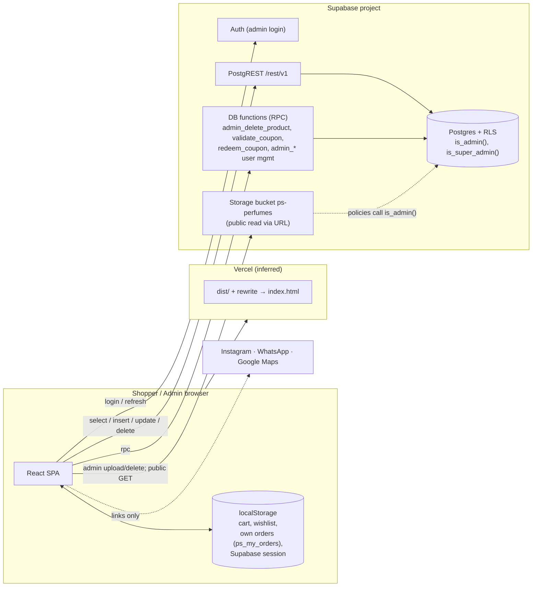

# 01 — Architecture and Data Flow

## 1. Summary

A **static React single-page app** (Vite build, served by a static host — Vercel per `vercel.json`) that talks **directly from the browser to Supabase**: Auth, Postgres through PostgREST, Storage, and a few **SECURITY DEFINER database functions** (RPCs) for operations the browser must not do directly. There is no application server, no serverless function and no background job. **Authorization is enforced by Postgres RLS, Storage policies and the checks inside those functions.**

## 2. Technology stack (verified)

| Technology | Version (range / installed) | Where | Why it matters |
|---|---|---|---|
| JavaScript + JSX (no TypeScript) | — | `src/` | No type checking |
| React / react-dom | ^19.2.8 / 19.3.0 | everywhere | UI |
| react-router-dom | ^7.18.4 | [App.jsx](../../src/App.jsx) | Client routing; needs SPA rewrite |
| @supabase/supabase-js | ^2.117.2 | [lib/supabase.js](../../src/lib/supabase.js), `src/services/*` | Only backend client |
| framer-motion, lucide-react | ^13.4.1, ^1.47.0 | UI | Animation, icons |
| Vite (+ @vitejs/plugin-react) | ^8.3.0 | [vite.config.js](../../vite.config.js) | Build; Node ≥ 20.19 / 22.12 |
| oxlint | ^1.81.0 | `.oxlintrc.json` | Only static check |
| Plain CSS, React Context state | — | component CSS, [CartContext.jsx](../../src/context/CartContext.jsx) | No UI kit / store library |
| Supabase | — | `.env`, `supabase/` | Auth, Postgres + RLS, Storage, RPC |
| Vercel (inferred) | — | [vercel.json](../../vercel.json) | Static hosting + SPA rewrite |

## 3. Diagram



## 4. Behaviour you must know

1. **Database is the single source of truth.** The demo-data fallbacks that existed before 2026-10-19 were removed. If a table is empty, the related section is empty or hidden; if a query fails, the error is logged (storefront) or shown (admin).
2. **Admin writes are confirmed.** Updates/deletes request the affected rows back; zero rows (typical when RLS blocks the write) is reported as an error. Helpers: [services/dbErrors.js](../../src/services/dbErrors.js).
3. **Homepage layout** uses the `homepage_sections` table if it has rows; otherwise the built-in layout in [services/homepage.js](../../src/services/homepage.js) (flagged `_default`). Admin → Homepage can save that layout to the database.
4. **Store settings** live in the key/value table `store_settings`; built-in defaults are used for keys not saved yet.
5. **Hero** is always the autoplay video `hero/ps-perfumes-hero-desktop.mp4` ([HeroCinematic.jsx](../../src/components/home/HeroCinematic.jsx)). `hero_slides` are admin-managed but not rendered.

## 5. Key flows

### 5.1 Checkout (COD)

```mermaid
sequenceDiagram
  participant U as Shopper
  participant C as CheckoutPage
  participant O as orders.js createOrder
  participant DB as Supabase
  U->>C: Place order (COD)
  C->>O: cart lines (selected variant price, bottle, size, qty), coupon
  O->>O: generate order id (UUID) + order number; recompute subtotal from lines
  O->>DB: insert orders (no read-back; payment_status = pending)
  alt insert rejected
    O-->>C: throw → error shown, cart kept
  end
  O->>DB: insert order_items (policy: order must be pending and < 30 min old)
  O->>DB: rpc redeem_coupon (if a coupon was used)
  O->>O: keep a copy in localStorage (ps_my_orders) for /track-order on this device
  O-->>C: confirmation
```

### 5.2 Coupon in cart
Cart/drawer → `applyPromoCode()` → `validate_coupon(code, subtotal)` RPC (visitors cannot read the coupons table) → coupon rule stored in cart state → discount recomputed on every cart change (0 below the minimum, never above the subtotal) → `Coupon: CODE` saved in `orders.notes` → `redeem_coupon()` increments `used_count`.

### 5.3 Admin login
`signInWithPassword` → `verifyAdminAuthorization()` ([adminAuthService.js](../../src/admin/services/adminAuthService.js)): primary admin e-mail, or active `admin_users` row, or `app_metadata.role`. `user_metadata` and e-mail patterns are **not** trusted (changed 2026-10-20). Non-admins are signed out.

### 5.4 Image upload (admin)
File → size/MIME check → `upload(path, { upsert: false })` to `ps-perfumes/<folder>/<slug>-<timestamp>.<ext>` → public URL **and** storage path saved in the record (`main_image_path`, `image_path`, `thumbnail_path`, or inside `products.fragrance_notes`). Details: [04](04-Cloud-Infrastructure.md) §7.

## 6. Cross-cutting

| Concern | Implementation |
|---|---|
| Routing | `react-router-dom` routes in [App.jsx](../../src/App.jsx); admin under `AdminRoute` |
| Code splitting | Admin pages and drawers lazy-loaded; vendor chunks |
| Caching | None beyond browser/Vercel defaults; Storage objects `cacheControl: 3600` |
| Errors / logging | Admin: banners with the real message. Storefront: console + friendly message. No error-tracking service |
| Security headers / CSP | None configured |
