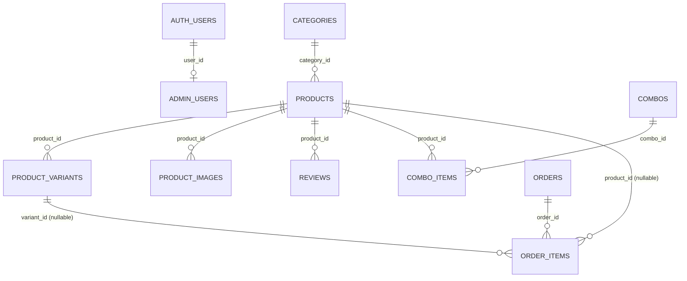

# 03 — Database and Data Model

## 1. Provider and access

- Supabase Postgres, accessed only through PostgREST/RPC with the publishable key and the user's JWT. No connection string is used by the app.
- **`supabase/schema.sql` is stale** and must not be used to recreate the database. The live schema below was verified on 2026-10-19 by column-existence probes with the public key (`select=<column>&limit=0`; no rows read). Columns not listed may still exist — export the full schema with `supabase db dump --schema public` (needs project access) and commit it.

## 2. Live schema (verified 2026-10-19)

| Table | Columns confirmed | Used by |
|---|---|---|
| `admin_users` | id, user_id, role, is_active, created_at, updated_at (**no** email/full_name/status) | is_admin(), admin login, Admin Users RPCs |
| `products` | id, name, slug, brand, description, short_description, category_id, main_image_url, main_image_path, fragrance_notes, ingredients, is_active, is_featured, is_bestseller, is_new_arrival, display_order, created_at, updated_at (**no** price/status/stock/sku/main_image) | storefront, admin |
| `product_variants` | id, product_id, bottle_type, size_ml, price, sale_price, stock_quantity, sku, is_active, created_at, updated_at | product pages, cart, inventory |
| `product_images` | id, product_id, image_url, image_path, display_order, is_primary, alt_text, created_at | not used by the UI; cleaned up by `admin_delete_product` |
| `categories` | id, name, slug, description, image_url, image_path, display_order, is_active, created_at, updated_at | collections, product form |
| `combos` | id, name, slug, description, image_url, image_path, price, sale_price, stock_quantity, is_featured, is_active, display_order, created_at, updated_at | combo section, Admin Combos |
| `combo_items` | id, combo_id, product_id, quantity, created_at (**no** name/bottle/size/image) | combos |
| `hero_slides` | id, title, subtitle, description, button_text, button_link, image_url, image_path, mobile_image_url, mobile_image_path, display_order, is_active, created_at, updated_at | Admin Hero only |
| `instagram_reels` | id, title, instagram_url, thumbnail_url, thumbnail_path, display_order, is_active, created_at, updated_at | reels section, /instagram |
| `homepage_sections` | id, section_key, title, subtitle, description, image_url, image_path, button_text, button_link, is_active, display_order, settings, created_at, updated_at | homepage layout |
| `store_settings` | id, setting_key, setting_value, created_at, updated_at (key/value) | Store Settings, cart shipping rule, contact dock |
| `coupons` | id, code, description, discount_type, discount_value, minimum_order_amount, usage_limit, used_count, is_active, starts_at, expires_at, created_at, updated_at | Admin Coupons, validate_coupon |
| `reviews` | id, product_id, customer_name, rating, title, review_text, is_approved, is_featured, created_at, updated_at | product page, homepage reviews, Admin Reviews |
| `orders` | id, order_number, customer_id, customer_name, customer_email, customer_phone, shipping_address (json), subtotal, shipping_amount, discount_amount, total_amount, payment_method, payment_status, order_status, notes, created_at, updated_at | checkout, admin |
| `order_items` | id, order_id, product_id, variant_id, product_name, bottle_type, size_ml, quantity, unit_price, total_price | checkout, admin, bestsellers |
| `customers` | id, email, phone, first_name, last_name, total_orders, total_spent, created_at, updated_at | dashboard count only |

**Do not exist live:** `site_settings`, `contact_enquiries` (optional migration creates it), `profiles`, `wishlists`, `cart_items`, `inventory`.

**Functions already in production (not in repo):** `is_admin()`, `is_super_admin()` (definitions unknown — captured by diagnostics section 03).

## 3. Relationships (inferred from columns and code; confirm FKs with diagnostics section 06)

Data conventions:
- `products.fragrance_notes` (JSON) also holds `glass_image`, `glass_image_path`, `pvc_image`, `pvc_image_path`, `gallery_images`, `category_name`, `sku`.
- Combos: `price` = regular price; `sale_price` = combo price when lower.
- `orders.notes` holds `Coupon: CODE` when a coupon was used. Combo lines in `order_items` have `product_id = null`.
- Image columns hold full public URLs; `*_path` columns hold the Storage object path.

## 4. RLS and permissions after the migration

| Table(s) | Visitors (anon) | Admin (`is_admin()`) |
|---|---|---|
| products, product_variants, categories, combos, hero_slides, instagram_reels | read rows with `is_active = true` | full manage |
| product_images, combo_items | read rows whose parent is active | full manage |
| homepage_sections | read all | full manage |
| reviews | read `is_approved = true` | full manage |
| store_settings | read only the public contact/shipping keys | full manage |
| coupons, customers | none | full manage |
| orders | **insert only**: pending, unpaid, `customer_id` null or self, total ≥ 0 | full manage |
| order_items | **insert only**: quantity > 0, price ≥ 0, order pending and < 30 min old | full manage |
| admin_users | none | read; writes **only** via super_admin RPCs |
| storage.objects (`ps-perfumes`) | none (files served by public URL) | select, insert, delete in allowed folders |

The migration adds policies (named `ps_*`); permissive policies are OR-ed, so **existing live policies remain in effect** and are listed by diagnostics section 02 for review.

## 5. Database functions (created by the migration)

| Function | Who | Purpose |
|---|---|---|
| `is_admin()` (replaced) | everyone | active admin_users row or `app_metadata.role` |
| `is_super_admin()` (replaced) | authenticated | same, super_admin only |
| `admin_delete_product(uuid)` | authenticated admin | archive-or-delete + unused image paths |
| `admin_list_admin_users()` | admin | admins with e-mail and last sign-in |
| `admin_grant_admin(email, role)` / `admin_update_admin(id, role, active)` / `admin_revoke_admin(id)` | super_admin | admin management with self-lockout protection |
| `validate_coupon(code, subtotal)` | everyone | coupon check without exposing the table |
| `redeem_coupon(code, order_id)` | everyone | +1 use, once per order, only for a fresh pending order whose notes record that code (note is marked "(redeemed)") |
| `ps_order_accepts_items(order_id)` | everyone | used by the order_items insert policy |

## 6. Migrations

| File | Status | Notes |
|---|---|---|
| `20261019_admin_media_and_product_delete.sql` | **Pending** | One transaction; preconditions; rollback at end. Procedure: [13](13-Production-Migration-and-Handover.md) |
| `20261020_contact_enquiries_optional.sql` | **Pending (optional)** | Creates `contact_enquiries` (insert-only for visitors) |
| `storage_and_permissions_fix.sql`, `schema.sql` | Historical | Never applied in this form; do not run |

## 7. Read-only checks

- `supabase/diagnostics/20261019_media_and_product_delete_diagnostics.sql` — one SELECT statement (one result grid): database/bucket, policies, admin functions with owners, admin rows, foreign keys, migration functions, hero file, RLS state and table owners, auth triggers, constraints, coupons, row counts. Writes nothing; prints no customer data (admin rows appear as ids and roles only; plus coupon rules and row counts).
- `supabase/diagnostics/20261021_storage_insert_simulation.sql` — one DO block + one SELECT: simulates anonymous and admin uploads and lists who is an admin under the current `is_admin()` (staff e-mails only). Every test is forced to roll back; no rows or files remain.

The Supabase SQL Editor shows only the last statement's result, which is why each file ends in a single result grid. Run each file in full and export the grid.
