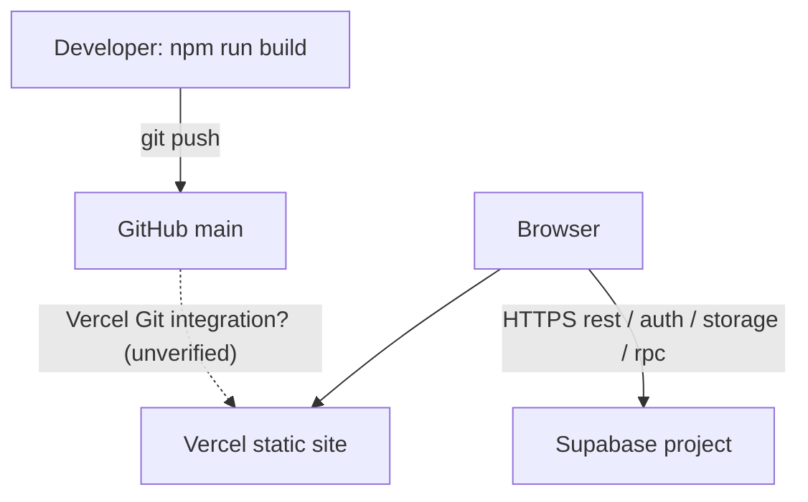

# 04 — Cloud Infrastructure

> No Supabase/Vercel/DNS console access was available. Items marked **Verified (live)** were checked through public endpoints only.

## 1. Services

| Service | Evidence | Status |
|---|---|---|
| Supabase (Auth, Postgres/PostgREST, Storage, RPC) | `.env`, supabase-js, live probes | Verified (live) — project host in `.env` (`<project-ref>.supabase.co`) |
| Vercel static hosting | `vercel.json` | Inferred — account/project unverified |
| GitHub `pathansameerkhan2001/PS_Perfumes` | git remote | Verified |
| Google Fonts | `index.html` | Verified |
| Domain `psperfumes.com` | `VITE_SITE_URL` | Unverified |

Not present: payment gateway, e-mail/SMS provider, error tracking, monitoring, CI, edge/serverless functions, infrastructure-as-code.

## 2. Topology

## 3. Supabase components

| Component | Notes | Logs |
|---|---|---|
| Auth | Admin e-mail/password only. Read 2026-10-20: public sign-up ON (disable recommended), e-mail confirmation ON, e-mail provider only. Still to verify: Site/redirect URLs, MFA | Dashboard → Logs → Auth |
| Postgres + PostgREST | Live schema in [03](03-Database-and-Data-Model.md); RLS after migration in 03 §4 | Logs → Postgres / API |
| RPC functions | Created by the pending migration | Logs → Postgres |
| Storage `ps-perfumes` | Public bucket, 50 MB limit, MIME jpeg/png/webp/mp4 (per repo SQL; confirm in dashboard). Public file URLs **verified** (hero video HTTP 206). Anonymous listing returns nothing | Logs → Storage |
| Backups | Plan-dependent; **unverified**. Storage files are not included in database backups | Dashboard → Database → Backups |

Free-plan projects pause after inactivity — confirm the plan before launch.

## 4. Vercel (inferred)

SPA rewrite in `vercel.json`. `VITE_*` variables must be set in Vercel and are baked in at **build** time (redeploy after changes). Rollback: Deployments → previous deployment → Promote / Instant Rollback.

## 5. Cost drivers

Supabase plan and egress (the homepage hero MP4 is streamed from Storage to every visitor), Vercel plan (Hobby is non-commercial), ~60 MB media duplicated in `src/assets` and `public/assets`.

## 6. Hero video

`ps-perfumes/hero/ps-perfumes-hero-desktop.mp4`, rendered by [HeroCinematic.jsx](../../src/components/home/HeroCinematic.jsx) as `autoPlay muted loop playsInline`, with a hard-coded absolute URL fallback. Do not move, rename or delete this object; product deletion only ever removes files under `products/`.

## 7. Media upload workflow (admin)

| Step | Implementation |
|---|---|
| Validate | [lib/storage.js](../../src/lib/storage.js): images ≤ 10 MB, video ≤ 50 MB; jpeg/png/webp/mp4 |
| Auth | Requires an admin session; enforced by Storage policy `ps_perfumes_admin_insert` (after migration) |
| Upload | `upload(path, { upsert: false, contentType, cacheControl: '3600' })` |
| Path | `<folder>/<slug>-<timestamp>.<ext>`; folders: products, hero, reels, categories, combos, logo, reviews, homepage, banners |
| Save | Form receives URL **and** path only after Storage confirms; saving the record stores both. Temporary previews are never saved |
| Display | Public URL `…/storage/v1/object/public/ps-perfumes/<path>` |
| Replace / remove | New uploads create new files. Product deletion removes `products/` files no other row references. Other entities' old files are **not** removed (orphans possible) |

Failure messages are the real Storage errors (403 policy, invalid key, MIME, size).

## 8. Live verification checklist (needs console access)

- [ ] Supabase project URL = `.env` `VITE_SUPABASE_URL`; plan, region, owner, not paused.
- [ ] Auth: public sign-up setting, e-mail confirmation, URLs, admin users list.
- [ ] Run diagnostics before and after the migration (see [13](13-Production-Migration-and-Handover.md)).
- [ ] Storage bucket settings and policies; hero object present.
- [ ] Backups / PITR availability.
- [ ] Vercel project, Git connection, env vars (Production + Preview), domain and HTTPS.
- [ ] GitHub repo visibility (`.env` is committed) and branch protection.
