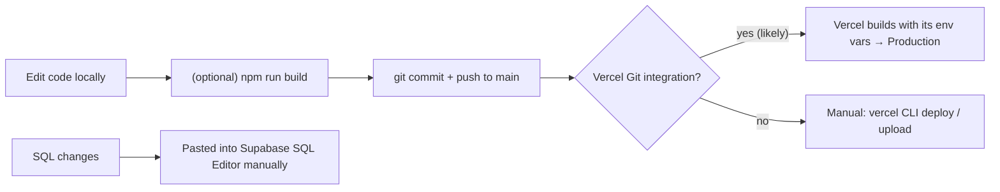

# 06 — Deployment and CI/CD

## 1. What exists

| Item | Status | Evidence |
|---|---|---|
| Source control | GitHub, single branch `main`; last commit `adf3dde` (2026-10-14). The 2026-10-19/20 fixes (≈45 files, SQL, docs) are **uncommitted** in the working tree | `git status` [Verified 2026-10-20] |
| Branching model | None — direct commits to `main` | [Verified] |
| CI workflows | **None** (no `.github/workflows`, no other CI config) | [Verified] |
| Automated tests | **None** | [Verified] |
| Hosting config | [vercel.json](../../vercel.json) (SPA rewrite) | [Verified] |
| Vercel project link | Not in repo (`.vercel/` absent) | [Unverified] how deploys are triggered |
| DB migration automation | None — SQL files applied manually | [Inferred] |
| Commit messages | Informal (e.g. "new-prodution-flex", "new-delopyment-from-clinet-has-been-push") | gives no reliable release history |

## 2. Build

| Command (from `package.json`) | What it does | Run during KT? |
|---|---|---|
| `npm run dev` | Vite dev server (default http://localhost:5173) | No |
| `npm run build` | `vite build` → `dist/` | **Yes** — ✔ succeeded on 2026-10-20 with all current changes (Node v24.12.0 / npm 11.6.2) |
| `npm run preview` | Serves `dist/` locally | No |
| `npm run lint` | `oxlint` | Last run 2026-10-19 before the fixes (65 warnings, 0 errors); not re-run since |

Build artefacts: `dist/index.html`, `dist/assets/*` (hashed JS/CSS chunks: `vendor-react`, `vendor-supabase`, `vendor-motion`, `vendor-icons`, per-admin-page chunks) plus everything copied from `public/`. The local `dist/` (2026-10-14) has the same chunk hashes as the KT build, i.e. it matches current source.

Requirements: Node `^20.19.0 || >=22.12.0` (Vite 8 `engines`). [Verified in `node_modules/vite/package.json`]

## 3. Probable current deployment process (reconstructed)



The diagram's decision point is **[Unverified]** — confirm in Vercel → Project → Settings → Git.

## 4. Environment-specific settings

There is only one known environment (production). No staging Supabase project or Vercel preview strategy is defined in the repo. Vercel Preview deployments (if enabled) would, with the same env vars, **talk to the production database** — be careful testing admin features on preview URLs.

## 5. Domain and DNS
`psperfumes.com` is the configured site URL. Registrar/DNS records are **not discoverable from the repo** — see the checklist in [04](04-Cloud-Infrastructure.md) §8.

## 6. Database migration timing

The current release needs the frontend **and** the migration together. The exact sequence (diagnostics → migration → deploy → verification) is in [13-Production-Migration-and-Handover.md](13-Production-Migration-and-Handover.md).

General rule for future changes: apply additive SQL first, deploy the frontend that uses it, and drop old columns only after the new frontend is stable. Database errors are now shown (admin) or logged (storefront) instead of being hidden behind demo data.

## 7. Release checklist (recommended, manual until CI exists)

Pre-deploy (local, no production impact):
```bash
cd E:\Ps_Perfumes\PS_Perfumes
npm ci            # clean install from lockfile
npm run lint
npm run build
npm run preview   # smoke test at http://localhost:4173
```
Deploy (production impact — do deliberately):
- Push to `main` (if Vercel Git integration is confirmed) **or** deploy via Vercel dashboard/CLI.

Post-deploy smoke test: see [11-Testing-and-Operations.md](11-Testing-and-Operations.md) §4.

## 8. Rollback

| Layer | How |
|---|---|
| Frontend | Vercel → Deployments → previous good deployment → **Promote to Production / Instant Rollback**. Or `git revert <sha>` and push. |
| Env vars | Restore previous values in Vercel, then redeploy (values are build-time). |
| Database | No scripted rollback. Write inverse SQL before applying any change; rely on Supabase backups/PITR (plan-dependent, [Unverified]). |
| Storage | No versioning; deleted/overwritten objects (uploads use `upsert: true`) cannot be restored unless backed up separately. |

## 9. Common deployment failures

| Failure | Symptom | Fix |
|---|---|---|
| Missing `VITE_*` in Vercel | Build OK, site white page, console "Missing VITE_SUPABASE_URL" | Add vars, redeploy |
| Deep link 404 | `/product/x` refresh → 404 | Ensure `vercel.json` rewrite is deployed |
| Node version too old on host | Vite 8 install/build errors | Set Node 20.19+ / 22.12+ in Vercel project settings |
| Lockfile mismatch | `npm ci` fails | Commit an updated `package-lock.json` generated with npm 10/11 |
| Large repo/assets | Slow builds/clones | De-duplicate `src/assets` vs `public/assets` |

## 10. Missing pieces (recommendations, not implemented)
1. GitHub Actions workflow: `npm ci && npm run lint && npm run build` on pull requests.
2. Branch protection on `main`; work on feature branches.
3. A staging Supabase project + Vercel Preview env vars pointing to it.
4. Supabase CLI migrations (`supabase/migrations/<timestamp>_name.sql`) checked into git, applied with `supabase db push`.
5. Conventional, descriptive commit messages / release tags.
